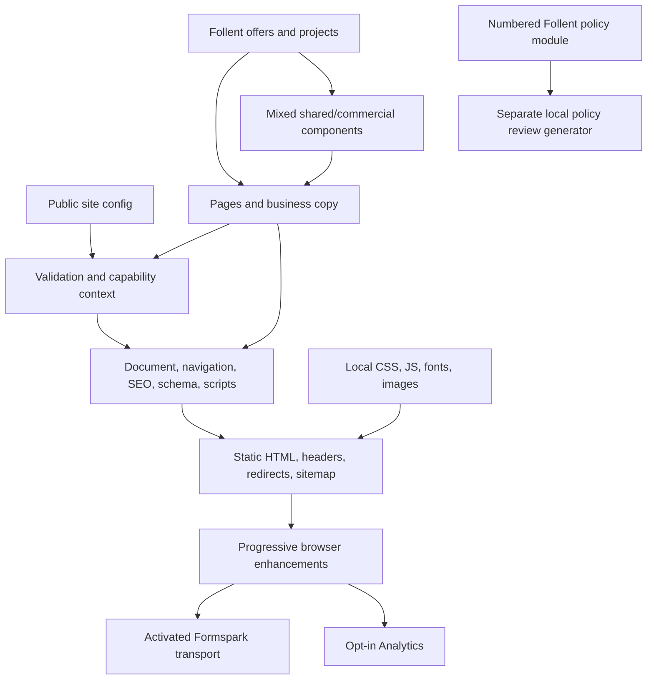

# Modularity and client-template review

Reviewed 12 October 2026 against commit `a6937e9` and a clean starting working tree. This review changes documentation only. Structural recommendations remain open in [TASKS.md](TASKS.md). No deployed commit/account settings were inspected.

Retain the static, dependency-free architecture. The main obstacle is the boundary between reusable rendering and Follent business composition, rather than missing framework features.

## Current dependencies

Normal `privacy(ctx)` in `content.mjs` renders the brief notice; its `privacyPolicy` import is unused. The review generator replaces that page using the numbered policy module. Earlier documentation claiming a unified rendering path was incorrect. This review corrects the description without changing public content.

| Module/group | Class | Responsibility and coupling |
| --- | --- | --- |
| `config/site.json` | FOLLENT values / ENGINE interface | Identity, brand, integrations and approval flags; contains active Follent settings. |
| `src/data/offers.mjs`, `projects.mjs` | FOLLENT | Commercial catalogue and reference evidence. |
| `src/pages/content.mjs` | Mixed | Copy/composition, page registry, generic hero, native enquiry markup and brief privacy. |
| `src/pages/privacy-policy.mjs` | FOLLENT | Numbered review policy with fixed operator/provider/practice facts. |
| `src/partials/components.mjs` | Mixed | Generic buttons/contact helpers plus direct offer imports and commercial sections. |
| `src/layouts/document.mjs` | Mixed | Reusable document/SEO/scripts; fixed navigation, schema type, font/social paths. |
| `src/lib/html.mjs` | ENGINE | Escaping, JSON-LD serialization, URL and money helpers. |
| `scripts/build.mjs` | Mixed | Safe generator/capabilities/security; fixed reference page and Essential alias rules. |
| `scripts/serve.mjs`, `check.mjs` | ENGINE with limits | Local global headers; checker loads default config independently of output `--dir`. |
| `assets/js/*` | Mixed | Navigation, provider transport and consent; website-specific intake conditions and Follent Analytics hook. |
| CSS/fonts/icons/social artwork | Mixed | Shared design patterns and Follent defaults; every build copies the same assets. |
| Tests and optional QA | Mixed | Strong safeguards alongside fixed page counts, business fields and social-image generation. |
| Root guides and dated reports | Mixed documentation | Onboarding/platform instructions mixed with business status and historical evidence. |

## Findings

| ID | Evidence and consequence | Resolution |
| --- | --- | --- |
| F1 | Identity-only cloning leaves approved Follent Formspark and GA active. No unsafe clone was served/submitted. | T01 |
| F2 | Normal brief privacy and separate numbered policy diverge. Numbered renderer retains Follent operator/email/Twenty under synthetic context; retention also differs from config. | T02 |
| F3 | Generic components import offers; all synthetic package homes still advertise website services and $2,190 pricing. Metadata, proof and intake choices also require editing. | T03 |
| F4 | Registry, navigation, package selection, Essential aliases and contact scripts are decided in different modules. Removing pages can leave links/scripts. Professional emits ten total pages including success/error utilities. | T04 |
| F5 | Gardening clone emits ProfessionalService schema. Font/icon/social paths are fixed, even when identity/canonical changes correctly. | T05; assets remain documented manual customisation |
| F6 | Review flags use truthiness without boolean validation; privacy email is not validated like business email. Launch checker reads default config, not custom build config. | T06 |
| F7 | README records Workers, but no Wrangler config is tracked. Automatic branch safeguard is Pages-specific. Tracked `.nvmrc` selects 22; live account settings remain unverified. | T07 |
| F8 | Tests assume 3/10 pages and Follent field/catalogue contract. Browser QA rewrites tracked social.png before testing. No generic different-business regression fixture. | T08 |
| F9 | Package/need options and conditional website field assume website services; form and Analytics share `follentTrack`. Provider transport is already separate. | T09 |
| F10 | Docs claimed numbered normal output and mixed Workers with Pages launch steps; branch safeguard language was overbroad. | Corrected in this review; T10 prevents recurrence |

Keep output deletion safeguards, native success/error paths and `_append=false`, narrow CSP hashes/origins, consent/DNT/GPC behaviour, local licensed fonts, package gates and independent inbox-delivery verification. No evidence justifies a new framework, component registry, wholesale CSS split or automated enforcement of commercial page allowances. Those choices remain explicitly unchanged.

## Disposable clone walkthrough

Fictional **Harbour Garden Care**, `https://harbour-garden.example`, synthetic `.example` contacts. Changed identity/legal name/domain/contacts/CTA/service area; otherwise copied configuration still computed formEnabled and analyticsEnabled true, with Follent endpoint and approval. This context was inspected only, not served.

Before generating clones, reset endpoint/site key/external URL, Formtrack, Google IDs, all approval flags, retention and redirects. Normal brief privacy then used the new privacy address. The separate numbered renderer still used James Follent, privacy@follent.net and Twenty: changing config does not rewrite it.

| Check | Essential | Professional | Growth |
| --- | --- | --- | --- |
| Total pages | 3 | 10 | 10 |
| New identity/canonical | Correct | Correct | Correct |
| Website-service sales copy and pricing | Still present | Still present | Still present |
| Schema | ProfessionalService | ProfessionalService | ProfessionalService |
| New privacy contact in normal brief notice | Correct | Correct | Correct |
| Old operator/Twenty in normal brief notice | Absent | Absent | Absent |
| Form/Analytics after safe reset | Off | Off | Off |
| Success/error utility files | Absent | Present | Present |

Remaining clone edits: replace service copy/metadata/composition, remove or replace offer/process/FAQ/managed modules and reference projects, adapt intake/browser conditions, review both privacy paths, choose schema/navigation/section aliases, replace favicon/social imagery, review fonts/licences/contrast, trim agreed page scope, select separate hosting and verify manual domain/migration instructions. Tasks cover these boundaries; assets and legal/factual approvals stay manual.

Copied-settings preview passed disabled fieldset, absence of Formtrack script, disabled form/Analytics and noindex headers/robots. Only Node static rendering and existing mocked transport tests were used; no browser loaded third parties for this review.

## Target structure and documentation authority

Keep the existing directories and ordinary ES modules. Generic primitives take data; Follent commercial composition supplies offers/copy; one page manifest feeds selection/navigation/section destinations; site config owns identity/capabilities/schema selection; reviewed content owns legal wording. The generator orchestrates these inputs rather than knowing which business sells websites. Do not move all prose into JSON or create a configuration framework.

README owns command/config/integration and hosting references. CLIENT_SETUP owns safe cloning. AI_CLIENT_BUILD_PROMPT refers to those sources. AGENTS owns engineering constraints; LAUNCH_CHECKLIST records decisions. QA_REPORT and provider/privacy reports retain dated evidence. Backlog items are not completed features.

Official platform guidance checked 12 October: [Workers builds](https://developers.cloudflare.com/workers/ci-cd/builds/configuration/), [Static Assets](https://developers.cloudflare.com/workers/static-assets/), [Workers headers](https://developers.cloudflare.com/workers/static-assets/headers/), [HTML handling](https://developers.cloudflare.com/workers/static-assets/routing/advanced/html-handling/) and [Pages build configuration](https://developers.cloudflare.com/pages/configuration/build-configuration/). Workers separates build/deploy/preview commands. Static-asset header rules do not automatically apply to Worker-generated responses. These sources verify platform behaviour, not Follent deployment settings.

## Verification and limits

Six Node tests pass; build generates ten pages; default output check passes. Test-generated Essential/Professional/Growth checks pass (3/10/10). Synthetic clone Essential/Professional/Growth and copied-settings preview checks pass (3/10/10/10). A structurally passing clone still has unsuitable website-service content/pricing.

Local ignored evidence: `.qa/architecture-review.mjs`, `.qa/architecture/results.json`, `.qa/architecture/` builds. This tracked report retains key observations if artifacts are unavailable. No browser/Lighthouse rerun, social-image generation, live submissions, account changes, deployment, DNS changes, external issues, commit or push. Earlier browser/provider results remain dated evidence, not new measurements. Live hosting, privacy operations and migration remain owner checks.

Documentation validation checks 11 guides/reports, 28 relative Markdown links/fragments and 33 references to existing npm scripts with zero failures. The proposed `check:docs` command in T10 is explicitly future work. Local evidence is `.qa/architecture/doc-results.json`; external guidance was read directly, not treated as a live account check. Final diff contains documentation only, with no source/config/asset edits.
